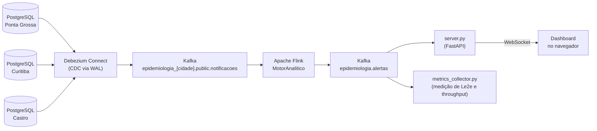

# Modernização de Sistemas Legados para Vigilância Epidemiológica em Tempo Real

Protótipo desenvolvido como Trabalho de Conclusão de Curso do Bacharelado em Engenharia de Software da Universidade Estadual de Ponta Grossa (UEPG).

**Autores:** Luís Eduardo Salles Rosa e Murilo Flores
**Orientador:** Prof. Márcio Augusto de Souza
**Coorientadora:** Priscilla Vanessa Alves Santos

---

## 1. A proposta

Os sistemas de vigilância epidemiológica brasileiros, como o Sinan, funcionam em boa parte por consolidação em lote: as notificações são registradas em bases locais, acumuladas e só depois consolidadas por níveis administrativos (municipal, estadual, federal). Entre o registro de um caso e a sua disponibilidade para análise, passam-se dias ou semanas.

Este projeto propõe uma **modernização incremental**: em vez de substituir o banco de dados legado, adiciona-se uma camada orientada a eventos ao redor dele. Cada inserção feita no banco é capturada no instante em que acontece, transportada por um barramento de mensagens, processada em fluxo e entregue a um painel em tempo real, sem executar consultas de varredura no banco operacional.

O objetivo é reduzir o tempo entre a persistência de um registro na fonte relacional e a sua disponibilização para a vigilância. Esse tempo é medido de ponta a ponta como **latência (Le2e)**, junto com a **vazão (throughput)** da arquitetura.

Para isso, o protótipo integra:

| Camada | Tecnologia | Papel |
|---|---|---|
| Origem | PostgreSQL 15 | Três bancos independentes, que simulam o legado de três municípios |
| Captura | Debezium 2.4 (CDC) | Lê o log de transações (WAL) e transforma cada inserção em um evento |
| Transporte | Apache Kafka 3.5.1 | Barramento de eventos durável e desacoplado |
| Processamento | Apache Flink 1.17.1 | Agrega as notificações em fluxo, com estado |
| Consumo | FastAPI + WebSocket | Entrega as contagens ao painel web em tempo real |

---

## 2. Visão geral da arquitetura



O fluxo tem quatro camadas lógicas:

1. **Origem e ingestão.** Os bancos legados recebem as notificações. O Debezium acompanha o WAL de cada banco e publica um evento JSON para cada inserção.
2. **Transporte.** O Kafka recebe os eventos brutos, com um tópico por município, e desacopla a origem dos dados do processamento.
3. **Inteligência.** O Flink consome os três tópicos, calcula a contagem de casos das últimas 24 horas por chave analítica e publica o resultado em um tópico de saída.
4. **Ação e consumo.** Um servidor lê o tópico de saída e retransmite as contagens por WebSocket para o painel. Um coletor independente lê o mesmo tópico para medir latência e vazão.

---

## 3. Como o projeto funciona

### 3.1 Origem: os bancos legados simulados

Cada município (Ponta Grossa, Curitiba e Castro) tem a sua própria instância do PostgreSQL, isolada das demais e configurada com `wal_level=logical`, requisito para a captura de mudanças. Cada instância recebe a mesma tabela, `notificacoes`, criada por `database/init.sql`:

| Campo | Descrição |
|---|---|
| `id_notificacao` | Chave primária sequencial |
| `dt_notificacao` | Data e hora do registro (`TIMESTAMP`, padrão `CURRENT_TIMESTAMP`) |
| `dt_sintomas` | Data de início dos sintomas (`DATE`) |
| `municipio_residencia`, `codigo_ibge`, `bairro` | Localização do caso |
| `doenca` | `DENGUE`, `MENINGITE`, `INFLUENZA` ou `POPULAR` |
| `cid_10` | Código CID-10 |
| `idade`, `sexo`, `status_caso` | Dados do paciente e situação do caso |
| `data_atualizacao` | Atualizada por trigger a cada `UPDATE` |

A doença `POPULAR` representa os atendimentos gerais, sem relação com os agravos monitorados. Ela povoa o banco com um volume realista de ruído.

### 3.2 Captura e transporte: CDC com Debezium e Kafka

O script `ativar_cdc_debezium.py` registra no Debezium Connect três conectores, `sinan-postgres-ponta-grossa`, `sinan-postgres-curitiba` e `sinan-postgres-castro`. Cada um usa o plugin de replicação lógica `pgoutput` e monitora a tabela `public.notificacoes` do seu banco.

A captura é **não intrusiva**: o Debezium lê o log de transações e não faz `SELECT` na tabela operacional. Cada inserção vira um evento JSON publicado em um tópico próprio do município:

```
epidemiologia_ponta_grossa.public.notificacoes
epidemiologia_curitiba.public.notificacoes
epidemiologia_castro.public.notificacoes
```

O envelope do Debezium traz, além dos dados da linha (`after`), o campo `source.ts_ms`: o instante de commit da transação no WAL do PostgreSQL, em UTC. Esse campo é a referência de origem usada na medição de latência (ver seção 4).

### 3.3 Processamento: o motor analítico no Apache Flink

O job `MotorAnalitico` (`flink-job/`, em Java) executa as etapas abaixo.

**Consumo dos três tópicos.** O `KafkaSource` assina os tópicos por expressão regular (`epidemiologia_.*\.public\.notificacoes`) e reavalia os tópicos e partições a cada 10 segundos (`partition.discovery.interval.ms`). Sem essa propriedade, o Flink descobriria os tópicos uma única vez, no momento em que o job sobe.

**Extração e normalização.** Cada mensagem do Debezium é decodificada e os campos de interesse são extraídos: município, código IBGE, bairro, doença, CID-10, identificador da notificação e o `source.ts_ms`. Textos são normalizados para maiúsculas, e registros sem município, código IBGE ou doença são descartados.

**Tempo do evento (Event Time).** A agregação usa o tempo do evento, obtido de `dt_notificacao` (com `dt_sintomas` como alternativa) e convertido para milissegundos. A estratégia de watermarks tolera 1 minuto de desordem e marca fontes ociosas após 10 segundos, para que uma partição sem eventos não trave o avanço do tempo.

**Chaves analíticas.** Cada notificação gera uma ou mais chaves de agregação:

| Chave | Quando é gerada |
|---|---|
| `DOENCA\|CIDADE\|<codigo_ibge>` | Para toda notificação |
| `DENGUE\|BAIRRO\|<codigo_ibge>\|<bairro>` | Adicionalmente, para dengue |

Portanto, uma inserção de dengue produz dois alertas (cidade e bairro), e as demais doenças produzem um.

**Contagem das últimas 24 horas com `KeyedProcessFunction`.** Para cada chave, o Flink mantém em estado a lista dos instantes das notificações que ainda pertencem à janela de 24 horas. Ao chegar uma notificação:

1. o instante dela é adicionado ao estado da chave;
2. um temporizador de Event Time é registrado para 24 horas depois, quando aquela notificação deve sair da contagem;
3. a contagem atualizada é emitida imediatamente.

Quando um temporizador dispara, as notificações vencidas são removidas do estado.

**Por que não usar a janela deslizante nativa?** A primeira versão usava `SlidingEventTimeWindows` (24 horas com deslizamento de 10 segundos). Nessa configuração o Flink replica cada evento em `24 h ÷ 10 s = 8.640` janelas simultâneas. O resultado foi o crescimento excessivo de estado e a contrapressão sobre o Kafka, o que impedia a atualização em tempo real. A `KeyedProcessFunction` reconstrói a mesma semântica temporal, em que cada notificação permanece na contagem por 24 horas, mas mantém um único estado por chave e emite a contagem a cada evento, sem esperar o próximo intervalo de deslizamento.

**Saída.** O job publica no tópico `epidemiologia.alertas` uma mensagem por evento processado:

```json
{
  "chave": "DENGUE|CIDADE|4119905",
  "doenca": "DENGUE",
  "municipio": "PONTA GROSSA",
  "codigo_ibge": "4119905",
  "bairro": "CENTRO",
  "tipo_agregacao": "CIDADE",
  "quantidade_casos": 14,
  "atualizado_em": "2026-09-15T22:40:12.345Z",
  "origem_ts_ms": 1789425138548,
  "id_ultima_notificacao": 87
}
```

`quantidade_casos` é a contagem acumulada das últimas 24 horas para a chave. `origem_ts_ms` carrega o `source.ts_ms` do Debezium para a medição de latência. O job usa paralelismo 2, faz checkpoints a cada 20 segundos e publica no Kafka com entrega *at-least-once*.

### 3.4 Consumo: o painel em tempo real

O `dashboard/server.py` (FastAPI) tem duas responsabilidades:

- **Consumir o tópico de alertas.** O consumidor não usa `group_id`: atribui as partições manualmente e, a cada inicialização, relê o tópico desde o início para reconstruir o estado, sem transmitir nada durante essa fase. Ao alcançar o fim do que já existia, passa a tratar cada mensagem nova como evento ao vivo. Assim o painel recupera os totais mesmo depois de reiniciado. O servidor aguarda o tópico existir sem limite de tentativas.
- **Servir o painel via WebSocket.** Cada alerta novo é enviado aos navegadores conectados junto com as estatísticas atualizadas.

Regras de contagem aplicadas pelo servidor:

- Cada chave só é atualizada se a nova contagem for maior que a anterior. Isso descarta duplicatas e mensagens fora de ordem, consequência da entrega *at-least-once*.
- Os totais usam apenas as chaves de nível `CIDADE`, para que o alerta de bairro da dengue não seja contado duas vezes.
- O conceito de **rodada** permite repetir testes sem reiniciar nada: `POST /api/reset` registra os valores acumulados atuais como linha de base e zera o painel, que passa a exibir apenas os casos posteriores.

O painel (`dashboard/index.html`) mostra o total de casos da rodada, o total por agravo, **um card por município** com o total e a contagem de cada doença, e um feed com as últimas contagens recebidas do Flink.

Endpoints do servidor:

| Rota | Descrição |
|---|---|
| `GET /` | Serve o painel |
| `WS /ws` | Canal de atualizações em tempo real |
| `GET /api/stats` | Estatísticas atuais |
| `GET /api/alertas` | Últimas contagens recebidas |
| `POST /api/reset` | Inicia uma nova rodada |

---

## 4. Simulação de carga e medição

O protótipo inclui o seu próprio ambiente de avaliação, que gera carga nos bancos legados e mede o que chega ao fim do fluxo.

### 4.1 Geração de carga

Os scripts em `simulator/` inserem notificações diretamente nos três bancos, com uma conexão por município. Cada um monta antes uma agenda com o instante, a cidade, a doença e o bairro de cada inserção, e depois a executa respeitando esses instantes. Os dois cenários comprimem **24 horas de notificações em 5 minutos de execução** (fator aproximado de 288×). Os volumes foram calibrados em escala reduzida, a partir de dados públicos de notificações do Sinan cruzados com o total de atendimentos do TabNet.

| Cenário | Script | Volume | Distribuição |
|---|---|---|---|
| Rotina | `basal.py` | 3.367 eventos (Ponta Grossa 372, Curitiba 2.979, Castro 16) | Aleatória ao longo dos primeiros 240 s do ciclo de 300 s |
| Surto | `surto.py` | 33.683 eventos (Ponta Grossa 3.725, Curitiba 29.796, Castro 162), ou seja, 10× a rotina | Uniforme ao longo de 95% do ciclo (carga sustentada ampliada, sem pico concentrado) |

Ambos aceitam `--seed` para execuções reproduzíveis e `--duracao` para alterar o ciclo. O `auditoria.py` insere um lote pequeno e controlado de casos e imprime o resumo do que foi enviado. Serve para conferir a contagem no painel.

### 4.2 Métricas

O `simulator/metrics_collector.py` é um consumidor Kafka independente do painel. Ele lê o tópico `epidemiologia.alertas` sem `group_id`, atribui as partições manualmente e se posiciona no fim do tópico, de modo que cada execução mede apenas os eventos gerados a partir daquele instante.

- **Latência ponta a ponta (Le2e)** = instante de recebimento no coletor − `origem_ts_ms`. O `origem_ts_ms` é o `source.ts_ms` do Debezium, o instante de commit no WAL, em UTC, que não depende de conversão de fuso horário.
- **Evento** = uma inserção no banco. Cada inserção gera exatamente um alerta de nível `CIDADE`, e só eles entram na latência e no throughput. Os alertas de `BAIRRO` (dengue) são contados à parte.
- **Throughput** = eventos `CIDADE` recebidos ÷ duração real da coleta.
- **Estatísticas de latência:** média, mediana, P95, P99, mínimo e máximo, calculadas sobre todas as amostras da execução.

Saídas geradas por execução:

| Arquivo | Conteúdo |
|---|---|
| `metricas_coletadas.csv` | Uma linha por segundo: eventos, alertas de bairro e estatísticas de latência da janela |
| `latencias_amostras.csv` | Uma linha por evento, com a latência individual e os instantes de origem e chegada |
| `resultados_performance_final.xlsx` | Os dois CSVs reunidos em abas (gerado quando `pandas` e `openpyxl` estão instalados) |

---

## 5. Como executar o pipeline completo

Os comandos abaixo são para PowerShell no Windows. Cada terminal começa na **raiz do repositório**, e as etapas 1 e 2 deixam um terminal ocupado cada, então use um terminal por etapa.

### Pré-requisitos

- Docker Desktop em execução.
- Python 3 com as dependências do painel, dos geradores de carga e do coletor:

  ```powershell
  pip install fastapi uvicorn kafka-python psycopg2-binary
  pip install pandas openpyxl    # opcional: gera o .xlsx com os resultados da medição
  ```

- Permissão para executar scripts `.ps1`. Se o Windows bloquear, rode uma vez:

  ```powershell
  Set-ExecutionPolicy -Scope CurrentUser RemoteSigned
  ```

### Passo 1: infraestrutura, CDC e job do Flink (terminal 1)

```powershell
.\subir-job.ps1 -Infra
```

O script sobe os containers, espera o Flink e o Debezium ficarem prontos, registra os três conectores de CDC (se ainda não existirem), compila o motor analítico com Maven em um container e submete o job ao Flink. As tabelas dos três bancos são criadas automaticamente na primeira subida, a partir de `database/init.sql`.

A primeira execução demora mais, porque baixa as imagens e as dependências do Maven. As seguintes usam o cache. O fim bem-sucedido é indicado por `Job 'Motor Analitico Epidemiologico' RUNNING`, e o estado do job também pode ser conferido em http://localhost:8081.

### Passo 2: painel em tempo real (terminal 2)

```powershell
cd dashboard
python server.py
```

Abra http://localhost:8501 no navegador. O servidor espera o tópico `epidemiologia.alertas`, que só passa a existir quando o Flink publica o primeiro alerta. Enquanto isso, ele imprime `[Kafka]Aguardando o tópico...` e começa a escutar sozinho assim que o tópico aparece. A mensagem `[Kafka] Consumer ao vivo` indica que o painel está pronto.

### Passo 3: gerar carga nos bancos legados (terminal 3)

Para uma conferência rápida, o `auditoria.py` insere 30 casos distribuídos entre as cidades e imprime o resumo do que enviou:

```powershell
cd simulator
python auditoria.py
```

Para os cenários completos (24 horas simuladas em 5 minutos):

```powershell
python basal.py     # Cenário Rotina
python surto.py     # Cenário Surto (10x o volume da Rotina)
```

Os dois aceitam `--seed 42` (execução reproduzível) e `--duracao 60` (ciclo mais curto). Ao final, cada script mostra quantos registros foram inseridos por cidade. Em uma rodada iniciada com o painel zerado, o total exibido no painel deve corresponder ao total inserido.

### Passo 4: medir latência e throughput (opcional)

O coletor se posiciona no fim do tópico de alertas e mede apenas os eventos gerados a partir daquele instante. Por isso, **inicie o coletor primeiro e o gerador logo em seguida**. Se o tópico ainda não existir, o coletor aguarda por cerca de 60 segundos.

Terminal 3, o coletor (305 s = 300 s do ciclo + 5 s de margem para os últimos eventos chegarem):

```powershell
cd simulator
python metrics_collector.py --duracao 305
```

Terminal 4, logo em seguida, o gerador:

```powershell
cd simulator
python basal.py     # ou surto.py
```

Ao final, o coletor imprime o resumo no console (throughput, média, mediana, P95, P99, mínimo e máximo) e grava `metricas_coletadas.csv`, `latencias_amostras.csv` e `resultados_performance_final.xlsx` no diretório de execução.

### Passo 5: repetir execuções

Para outra rodada, sem recriar o ambiente, zere o painel:

```powershell
Invoke-RestMethod -Method Post http://localhost:8501/api/reset
```

O Flink continua em execução e mantém as contagens acumuladas das últimas 24 horas. O `reset` faz o painel exibir somente os casos posteriores a ele. Cada nova execução do coletor já começa no fim do tópico, sem herdar dados da anterior.

Se o código do motor analítico for alterado, recompile e republique o job sem mexer na infraestrutura:

```powershell
.\subir-job.ps1
```

O script aceita `-SkipBuild` (só reenvia o jar já compilado) e `-SkipCdc` (não verifica os conectores Debezium).

### Verificação opcional

```powershell
# conectores do Debezium registrados
Invoke-RestMethod http://localhost:8083/connectors

# últimas mensagens publicadas pelo Flink
docker exec -it kafka kafka-console-consumer --bootstrap-server localhost:9092 --topic epidemiologia.alertas --from-beginning --max-messages 5
```

### Encerrar

Pare o painel com `Ctrl+C` e derrube os containers:

```powershell
docker compose -f infra/docker-compose.yml down
```

Como o ambiente não usa volumes persistentes, isso remove os dados, os tópicos e os conectores. Ao subir de novo, execute o passo 1 outra vez: o script registra os conectores novamente.

---

## 6. Componentes e portas

| Serviço | Container | Porta no host |
|---|---|---|
| PostgreSQL, Ponta Grossa | `postgres-ponta-grossa` | 5433 |
| PostgreSQL, Curitiba | `postgres-curitiba` | 5434 |
| PostgreSQL, Castro | `postgres-castro` | 5435 |
| Zookeeper | `zookeeper` | — |
| Apache Kafka | `kafka` | 9092 (host) e 29092 (rede interna) |
| Debezium Connect | `debezium-connect` | 8083 |
| Flink JobManager (UI e API REST) | `flink-jobmanager` | 8081 |
| Flink TaskManager (2 slots) | `flink-taskmanager` | — |
| Painel (FastAPI) | processo local | 8501 |

O Kafka expõe dois endereços: `kafka:29092` para a comunicação entre containers (Flink e Debezium) e `localhost:9092` para os processos executados no host (painel e coletor).

O script `subir-job.ps1` automatiza o ciclo de publicação do job. Ele verifica os containers e o Flink, garante que os três conectores Debezium estejam registrados e em execução (invocando `ativar_cdc_debezium.py` quando faltam), compila o projeto com Maven em um container (sem exigir Maven instalado na máquina), cancela jobs anteriores pela API REST do Flink, envia o jar ao JobManager e submete o novo job em modo *detached*.

---

## 7. Decisões de projeto

- **Captura pelo log, e não por consultas.** O CDC via WAL evita sobrecarregar o banco operacional e preserva o sistema legado sem alterações.
- **Um tópico por município.** A origem de cada município fica isolada, e o processamento consome todos por expressão regular.
- **Dois tempos distintos.** O tempo do evento (`dt_notificacao`) governa a janela de 24 horas. O `source.ts_ms` do Debezium serve apenas para medir a latência, porque `dt_notificacao` é um `TIMESTAMP` sem fuso horário e pode ser interpretado de forma ambígua.
- **Estado por chave, e não por janela.** A `KeyedProcessFunction` evita a multiplicação de estado das janelas deslizantes nativas e atualiza a contagem a cada evento.
- **Entrega *at-least-once*.** O tópico de saída pode receber duplicatas após recuperações de falha. Como as contagens são acumuladas, o consumidor as descarta ignorando valores que não superam o anterior.
- **Ambiente efêmero.** Os containers não usam volumes persistentes: ao recriar o ambiente, os dados, os tópicos e os conectores são recriados, e a etapa de registro dos conectores faz parte da inicialização.
- **Execução em host único.** Os serviços executam como containers de uma mesma máquina. A medição reflete o desempenho do pipeline, sem efeitos de uma rede de longa distância entre as camadas.
